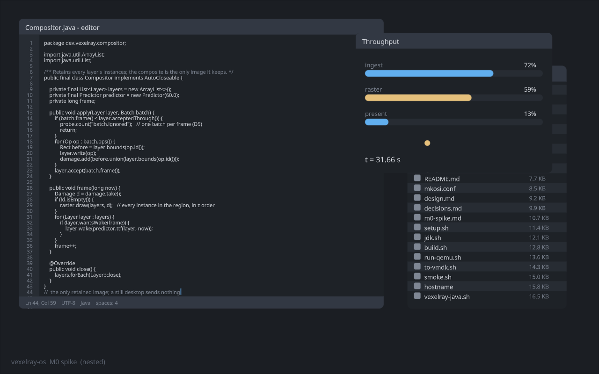

# M0 spike

Status: **run 2026-10-23**. A throwaway first pass at milestone M0 ([design.md](design.md) §12), built to put numbers
behind D2 before the gaps M0 depends on are closed in their own libraries. It breaks §1 ("nothing re-implemented") on
purpose; every shim is listed below with the gap it stands in for. The code is `compositor/`; the raw reports and a
screenshot are in [m0/](m0/).

## What was built

- **A nested compositor** (`Compositor`): a VexelRay application on `VexelEngine`, in a 1280x800 window. It
  retains every program's instances, applies batches on arrival, rasterizes damage into a retained composite with
  scissored draws, and presents the composite by drawing it as one canvas image. It wakes programs with a TTF only
  when they must act.
- **Three programs**, each its own JVM with no GPU device: an **editor** (text-heavy, woken by keystrokes), a
  **dashboard** (animated, woken every frame while asked, samples its animation at the TTF's present time) and a
  **file list** (woken once, then moved by the compositor without being told). They draw with today's `Canvas` and
  send instance batches.
- **The instance** (G1 in miniature): 32 floats, 128 bytes, against six fat `CanvasVertex` vertices (648 bytes). An
  instanced vertex shader, written in `core` IR, rebuilds the six vertices from `VertexIndex / 6`. The fragment
  shader is the canvas's own, unchanged, so the looks and the MSDF text are exactly the canvas's. Conversion is exact
  for axis-aligned primitives (`InstancesTest`).
- **The wire**: a Unix socket for 48-byte control messages, and one shared-memory file per program in `/dev/shm` for
  batches (the copy path). A batch carries upserts (id plus 31 floats) and removals (id).

Run it with `compositor/run.sh run` (the scripted timeline below) or `compositor/run.sh sweep` (raster cost against
instance count); add `offscreen` to save the last frame as a PNG.

### The timeline

Six seconds per phase, after a second to settle once all three programs have sent their first batch:

| Phase | What happens |
|---|---|
| still | nothing |
| typing | about twelve synthetic keystrokes a second to the editor, each a wake with the key |
| animating | the dashboard woken every frame |
| moving | the compositor drags the file list around; no program is told |
| all at once | typing, animating and moving together |

The dashboard also resends every 30th batch for the same frame, deliberately, to exercise D5.

## Where it ran

Tier B, and the bottom of it: the VMware VM with **no GPU passthrough**, so Vulkan is **llvmpipe** (Mesa 26.0.8,
rasterizing on the CPU), with **2 vCPUs** shared by the compositor, llvmpipe's threads and three program JVMs. Ubuntu
26.04, JDK 25. The window is never mapped (a background run), but the engine's FIFO present still paces frames to the
virtual display's 58.3 Hz. "Presented" below means handed to the presentation engine, measured as the start of the
next frame.

Every raster number here is CPU rasterization. On the NVIDIA laptop it will be a different order of magnitude; the
message, byte, prediction and latency-structure numbers carry over better.

## Results

The full tables are [m0/run.md](m0/run.md) and [m0/sweep.md](m0/sweep.md). Two windowed runs and one offscreen run
agreed to within a few percent. The runs predate one fix: the raster drew each window's live instance count, which a
batch arriving mid-raster could put ahead of what had been uploaded, for an extra stale instance or a missing one in
that frame's damage. It now draws the count uploaded with the data. That could only cost pixels, not change a
number here.

### Volume (D2)

| | Instances | Retained | One RGBA8 buffer of its pixels | First batch |
|---|---|---|---|---|
| editor, 780x620 | 1,060 | 136 KB | 1.93 MB | 134 KB, applied in 0.7 to 1.2 ms |
| file list, 340x520 | 367 | 47 KB | 707 KB | 48 KB |
| dashboard, 420x300 | 55 | 7 KB | 504 KB | 7 KB |

As fat vertices the editor would be 687 KB, five times its instances. A Wayland client would hold two or three
buffers of 1.93 MB before the compositor's copy.

Steady state, per batch (p50 / p95 / max):

| | Bytes | Ops | Apply on arrival |
|---|---|---|---|
| a keystroke (glyph, cursor, status line) | 404 / 536 / 2,780 | 3 | 0.02 ms |
| a dashboard frame | 1,064 / 1,328 / 2,120 | 8 | 0.01 ms |

So an animating window costs about 62 KB/s on the wire, and applying a batch is noise.

### Raster

The sweep: full-screen windows of 11 px text, p50 on llvmpipe. Past 64 lines the text is stacked 3 px apart, which is
overlapping windows. The last row is 128 lines cut off at 16,384 instances, the most a window holds in the spike (128
glyphs dropped).

| Instances | Whole screen | One 220x18 rect |
|---|---|---|
| 516 | 1.19 ms | 0.56 ms |
| 2,064 | 3.38 ms | 0.61 ms |
| 4,128 | 5.89 ms | 0.83 ms |
| 8,256 | 11.89 ms | 2.24 ms |
| 16,384 | 22.99 ms | 4.19 ms |

About 1.4 ms per thousand glyph instances for the whole screen. In the timeline, with realistic damage:

| Phase | Damaged px per frame | Raster p50 / p95 | Frame rate |
|---|---|---|---|
| typing | 414 | 0.66 / 1.91 ms | 58.0 |
| animating | 13,061 | 1.34 / 2.30 ms | 58.1 |
| moving | 167,237 | 4.86 / 6.20 ms | 58.2 |
| all at once | 238,277 | 6.20 / 8.47 ms | 57.8 |

No phase dropped below the display's rate.

### Messages (D6)

| Phase | Messages per frame | Compositor work per frame (p50) |
|---|---|---|
| still | **0** | 0.01 ms |
| typing | 0.40 | 0.01 ms |
| animating | 1.99 | 1.44 ms |
| moving | **0** | 4.87 ms (all raster) |
| all at once | 2.40 | 6.32 ms |

### The TTF (D7) and one batch per frame (D5)

- **832 of 833 batches landed in the frame their TTF named.** The one late batch came while everything ran at once.
- **The predicted present time was off by 0.1 to 0.3 ms at p50, and by at most 5.3 ms at p95.**
- **D5 ignored exactly the 23 duplicates the dashboard sent on purpose, and nothing else.**

### Latency

From wake to present: **28 to 35 ms at p50, which is two frames.** Of that, the socket, the program and the apply
together take under 1 ms at p50 (the program's own work is 0.1 to 0.8 ms at p50 and up to 4 ms at p95).

## Findings

1. **D2 holds on tier B's copy path, for realistic windows.** Batches are hundreds of bytes to a few kilobytes,
   applying them is free, and a text-heavy window retains a fourteenth of one buffer of its pixels. The trigger
   ("instance volume makes the copy path miss frames for a realistic window") was not reached. The limit on llvmpipe
   is raster, not volume. A full-screen redraw stops fitting a 60 Hz frame at about 10,000 glyph instances.

2. **A still desktop is free, and so is moving a window (D6, D9).** Zero messages in both phases. A move is pure
   compositor raster from retained data, with the program never told.

3. **New: a batch that arrives before its TTF frame must be held until that frame.** The spike first drew such
   batches at once. A wake predicted to need two frames, for example a slow first keystroke while the JIT warms up,
   got a batch that arrived early and was drawn a frame before the present time it was sampled for. The next finding's
   rule then kept every later TTF one frame ahead. From then on the dashboard's animation was shown a full frame
   early, with a 17 ms prediction error at p50, while every batch counted as on time. Holding early batches, with the
   wake kept outstanding so the program cannot overwrite shared memory still in use, brought the error to 0.1 ms.
   Recorded as D14.

4. **New: a TTF must never name a frame the program already has a batch for.** Otherwise the compositor itself
   provokes D5: a fast answer to a later wake targets the same frame as a slow answer to an earlier one, and is
   ignored. The rule is TTF ≥ last accepted frame + 1. Part of D14.

5. **The two-frame latency is the frame structure, not the protocol.** Wakes go out at the end of a frame, and the
   raster happens at the next frame's start, so an answer that arrives 0.3 ms later still waits most of a frame. The
   spike does not rasterize on arrival (D8) and does not wake on input as it arrives. Those two are what would shorten
   it. M0 says nothing for or against D8.

6. **Damage-scoped raster needs culling, not only a scissor (G7).** One 220x18 rect costs 0.56 ms over 500
   instances and 4.19 ms over 16,000. Every instance of every window under the rect is vertex-shaded, then clipped.
   G7's "cull by bounds" is not optional.

7. **The predictor was not stressed.** Programs answered in well under a millisecond against about 15 ms of slack.
   A 100% hit rate here does not mean the predictor is honest under load. M0's question about how often the
   predictor is wrong needs heavy programs, or a deliberately slow one.

8. **The present path is a full-screen draw every frame.** The composite reaches the swapchain as one full-screen
   canvas image, whatever the damage. In the offscreen sweep a frame with no damage still cost about 8 ms of engine
   work on llvmpipe. Windowed, it hides inside the vsync wait, so it could not be measured separately. Per-image
   damage history and incremental present (§4) are what remove it.

## Shims, and the gap each stands in for

| Shim in the spike | Gap |
|---|---|
| A hand-rolled fixed message layout, no version, no checked decode | M2, M3; atchung, elektro-Q, intrabuf |
| Shared memory opened by path in `/dev/shm`, not an fd over `SCM_RIGHTS` | M1 |
| `Canvas` vertices converted to instances in the program | G1 |
| A copy of `BoundStorageBuffer` visible to the vertex stage; `StorageBuffer` fields reached by reflection | G1 |
| Whole window re-emitted every wake, diffed against the last; ids from item keys the program picks | G2 |
| A load-op render pass over `SampledColorTarget`'s framebuffer, reached by reflection | G7 |
| Scissor only, no culling; one draw per window per damage rect | G7, and §4.1's one draw |
| Every wake's reason decided by the compositor's script, not declared by the program | §6 capabilities |
| Synthetic keystrokes, no input routing | T1, T3 |

Not built at all: instance animations, the choreographer, rasterize on arrival and the cut-off (§3.3, §3.4), per-field
deltas (an upsert is a whole instance), images and program-rendered images, per-instance look records, rotated
primitives, quotas, the sandbox.

## What next

- **The laptop.** Rerun on the NVIDIA laptop (tier A) for raster numbers that mean something, and on the VM with SVGA3D
  if it can be had. The hybrid-GPU spike still stands, independent of this.
- **Close G1, G2 and G7 properly** in vexelray and vexelray-gui, then rebuild M0 on them. Culling first: it is the
  biggest raster lever the spike found.
- **Stress the predictor**: a program that takes most of a frame, a variable one, and many programs at once.
- **Try rasterizing on arrival and waking on input as it arrives**, and measure what they take off the two frames.
